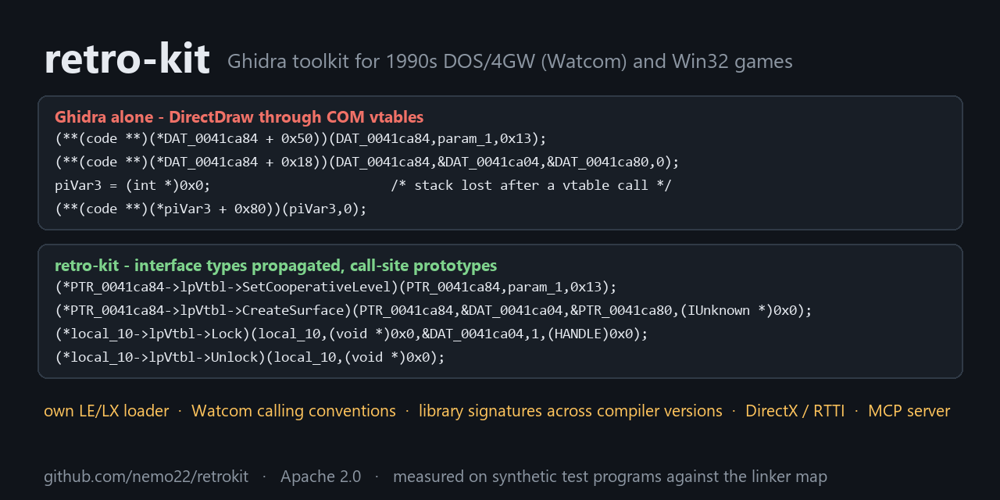

# retro-kit – reverse engineering old games (headless Ghidra)



A toolkit for decompiling 32-bit games from roughly 1993–2010 with headless Ghidra:

- **DOS LE/LX** (DOS/4GW, DOS/32A, PMODE/W, CauseWay, DOS/4G bind; also OS/2 LX and VxD)
  built with Watcom C/C++ – with its own LE/LX loader for Ghidra and Watcom compiler specs for
  both calling conventions.
- **Win32 PE** (typically MSVC): DirectX calls through COM vtables shown with their method
  names, Miles/Smacker/Bink/FMOD/BASS imports typed, C++ classes from MSVC RTTI, the
  compiler version from the Rich header.

The output is a workspace with one large `.c` file holding every function plus indexes
(functions, call graph, strings, fixups/pointer tables, imports) that you can grep and split up
between people or AI agents. Names found during the analysis go back into Ghidra and the export
is regenerated.

## Install

Prerequisites: [Ghidra 12.x](https://github.com/NationalSecurityAgency/ghidra/releases)
(unpacked), a JDK 21+ (`JAVA_HOME`), Python 3.10+.

```
pipx install git+https://github.com/nemo22/retrokit   # or from a checkout: pip install .  (or python -m retrokit)
retrokit doctor                                    # checks Python, Ghidra, Java, loader, cspecs
retrokit install-loader                            # once per Ghidra install (DOS LE/LX only)
```

Ghidra is found via `--ghidra DIR`, `$GHIDRA_INSTALL_DIR`, or a `ghidra`/`ghidra_*` directory next
to the game or the kit. `install-loader` compiles the loader with `javac` against that Ghidra
(no Gradle), installs it into `Ghidra/Extensions` and registers the Watcom compiler specs; run it
again after updating Ghidra (`doctor` tells you when).

## Use

```
retrokit info GAME.EXE              # format, DOS extender, compiler, calling convention
retrokit analyze GAME.EXE           # full pipeline -> GAME_analysis/  (-o DIR to choose)
retrokit show GAME_analysis FUN_00012345 main
retrokit tables GAME_analysis       # function-pointer and string tables (from fixups)
retrokit names GAME_analysis        # apply notes/names_*.csv, re-export
retrokit reexport GAME_analysis     # re-run the fix-up passes + export without re-importing
```

`analyze` detects the format, the loader and – for Watcom – the calling convention
(`--cspec watcom|watcomreg` overrides it) and stores them in `GAME_analysis/retrokit.json`;
later commands only need the workspace. A workspace:

```
GAME_analysis/
  retrokit.json        how the binary was analysed
  decomp/              <exe>_decompiled.c, functions.csv (addr,name,size,callers,callees,cc,signature),
                       calls.txt, strings.txt, data_symbols.txt, memory_blocks.txt,
                       fixups.txt (source -> target of every pointer: the key to pointer tables
                       and to which function uses which string), imports.txt (PE)
  notes/               findings, names_<topic>.csv proposals
  ghidra_project/      the Ghidra project (open it in the Ghidra GUI too)
  logs/
```

**AI agents**: `retrokit mcp GAME_analysis` is an MCP server (stdio, no extra packages) over
the workspace: functions, decompiled code, call graph, cross references, strings, pointer
tables, disassembly and bytes, libraries; it records name proposals and notes and can
re-export with the names applied (on request, in the background). Claude Code:

```
claude mcp add retrokit -- retrokit mcp /path/to/GAME_analysis
```

Setup for other clients, every tool and how an agent should work: [docs/MCP.md](docs/MCP.md);
a short version for agents in [AGENTS.md](AGENTS.md).

Names: write proposals to `notes/names_<topic>.csv` (`addr,name,confidence,comment`, confidence
`V` verified or `G` guess); `retrokit names WS` renames functions/labels (V wins over G,
collisions get `_<addr>`) and re-exports.

What the pipeline does:

- **Libraries** (both formats): `retrokit libs` (also part of `info` and `analyze` ->
  `notes/libraries.md`) recognises ~20 libraries of the period - Miles/AIL, HMI SOS, DIGPAK,
  Smacker, Bink, FMOD, BASS, DirectX, zlib, libjpeg, libpng, PKWARE DCL, Lua, ... - from
  strings, imports and data files, with version, notes on their formats and port hints.
  Library code is found by signature (shipped: Watcom C/C++ run-time, math and C++ libraries
  from Open Watcom, zlib 1.0.4-1.2.3, libjpeg 6b; `retrokit sigs build` makes them from
  libraries you own, `sigs learn` from functions you identified) - exact matches first, then
  similar code from other compiler versions - named, and typed from `retrokit/knowledge/*.h`.
- **LE/LX**: import with the LE loader and the Watcom cspec, functions at the targets of fixups
  into code (Watcom games call much of their logic through pointer tables), `switch` jump tables
  kept inside their functions, wrong "no return" flags undone, short strings defined and string
  literals shown as `"text"`, parameter counts from the `ADD ESP,n` cleanups at call sites,
  prototypes recovered callees-first, export.
- **PE**: import with Ghidra's PE loader and auto-analysis, then functions at pointer-table
  targets and after padding until no new ones turn up, the same string / parameter / prototype
  passes, export.

Other commands: `classes` (MSVC C++ classes from RTTI), `libs` (libraries in use), `convert` (XMIDI/HMI/HMP -> MIDI, VOC -> WAV,
Smacker/Bink/FLIC -> MP4, by content), `sigs match|build|learn` (library signatures, see
`docs/WORKFLOW.md`),
`entries` (PE: code addresses without a function), `modules --rules FILE`
(PE: functions → original source files via assert paths), `strings EXE OUT` (PE string inventory
without Ghidra), `match` (transfer names to a related EXE: sequel, add-on, other version),
`le EXE info|dump|rec|s16|s32` (read tables from an LE at Ghidra addresses), `rnc` (RNC ProPack),
`flic info|png|video` (Autodesk FLI/FLC). `retrokit COMMAND --help` for options.

The detailed procedure, what to expect and the known pitfalls are in `docs/WORKFLOW.md`; the
MCP server in `docs/MCP.md`; task templates for AI agents in `docs/AGENT_PROMPTS.md`; planned
work in `docs/ROADMAP.md`; maintaining and releasing in `docs/MAINTAINING.md`.

## Layout

```
retrokit/               Python package (CLI: retrokit/cli.py)
  ghidra_scripts/       headless Ghidra scripts used by the pipelines
  tools/                standalone Python tools behind the CLI commands
  le-loader/            LE/LX loader for Ghidra (Java) + Watcom compiler specs (data/languages/)
  sigs/                 library signatures (Open Watcom C run-time)
  knowledge/            libraries.json (library catalog), library prototypes as C headers
scripts/                build_sigs.py: rebuilds the shipped signatures
tests/                  synthetic test programs, scoring against the linker map, baseline
docs/                   WORKFLOW, AGENT_PROMPTS, ROADMAP
```

| Ghidra script | purpose |
|---|---|
| `CreateFunctionsFromFixups.java` | LE: functions at the targets of 32-bit fixups into code; switch tables in code |
| `CreateFunctionsAtEntries.java` | functions at given addresses (list or `@file`), optionally from fixups or prologues in code gaps |
| `FixTruncatedCallers.java` | clears a wrong "no return" that truncates callers |
| `FixAnalysis.java` | manual fixes: `noreturn:ADDR`, `func:ADDR` |
| `MarkStringsConstant.java` | defines short strings, marks strings in writable data `constant` (literals in the decompilation) |
| `ApplyLibraryPrototypes.java` | documented prototypes for named library functions (`knowledge/*.h`), tag `LIBRARY` |
| `ApplyStackConvention.java` | parameter counts / `__cdecl` / varargs from `ADD ESP,n` at call sites, `__stdcall` from `RET n` |
| `RecoverPrototypes.java` | prototypes from the decompiler, bottom-up by call-graph level |
| `ApplyNames.java` | names from `names_*.csv` |
| `ExportDecompiled.java` | exports `.c` + `functions.csv`, `calls.txt`, `strings.txt`, … |
| `DumpFixups.java` | LE fixups / PE base relocations → `fixups.txt` |
| `DumpImports.java` | PE imports and IAT slots → `imports.txt` |
| `DumpFunctions.java` | function list only (between PE entry passes) |
| `DumpDisasm.java` | disassembly of a function to stdout |
| `EnableDeepAnalysis.java` | turns on the slow analyzers (not recommended, see WORKFLOW) |

## Tests

`tests/` builds small synthetic programs with Open Watcom (a dev/CI dependency only: DOS/4GW,
DOS/32A, PMODE/W, DOS/4G bind, OS/2 LX, Win32; stack and register convention), checks the
loader against an independent Python model of each image, runs `retrokit analyze` on them and
scores the result against the linker map (function addresses, parameter counts, call arguments,
string literals, truncated functions, decompiler noise). See `tests/README.md`.

## Contributing

Issues and pull requests are welcome on GitHub. The primary repository is maintained
elsewhere and mirrored to GitHub, so pull requests are merged there and show up on GitHub
as merged once the mirror has synchronised (`docs/MAINTAINING.md`). Please do not attach
game files or decompiled game code; describe the binary instead (format, extender,
compiler, what goes wrong) and, where you can, reproduce it with a small program built
with Open Watcom like the ones in `tests/`.

## License

Apache License 2.0 (`LICENSE`). Earlier versions of the kit used
[yetmorecode/ghidra-lx-loader](https://github.com/yetmorecode/ghidra-lx-loader); the current
loader (`retrokit/le-loader`) is a new implementation.

retro-kit contains no game files and no decompiled game code. Use it only on software you own.
