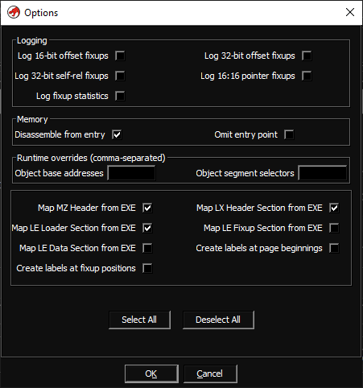

# Ultimate Ghidra Loader for the LX/LE executable file format

Download a zip matching your Ghidra version from [releases](https://github.com/yetmorecode/ghidra-lx-loader/releases) and install it from `File > Install extensions...`

## Features

* Supports LE/LX files in various formats:
  * OS/2 LX-Style
  * MSDOS DOS/16 LE-Style
  * MSDOS DOS/4 LE-Style
  * DOS32A sb.exe unbound LE/LX-Style
  * Windows Virtual Device Driver (VxD)
* Full page-map and fixup (relocation) support
* Completely typed executable headers (and other image data) with comments

Optionally, various options can be specified individually for each file:

* Manually override the object base addresses and segment selectors (good for syncing with a debugger / DOSBox)
* Map various image data to an overlay:
  * Map MZ Header
  * Map LX Header
  * Map LX Loader Section
  * Map LX Fixup Section (fully typed!)
  * Map LX Data Section (i.e. the unmodified page data)
* Create labels for each fixup in memory
* Create labels for each page beginning in memory
* Log fixup statistics / Log individual fixup types

## Tested with

* DOS/4GW LE games (bound and unbound)
* DOS/16 LE and unbound LE-style executables
* Various files compiled with Open Watcom (DOS32A LE)
* Random VxD files

## Extra

## Manually overriding base addresses and segment selectors

The loader can be instructed to manually override the base addresses and selectors of the executable's objects. I use this to feed Ghidra the same memory layout and segment selectors as I find in the dosbox debugger. In return I can use the same addresses found in Ghidra to set breakpoints in the debugger etc.

To override the base addresses, just enter a comma-seperated list of hex values into the field.

The loader will adjust the locations (and fixups!) accordingly.

## Resources

* https://ghidra-sre.org/
* https://moddingwiki.shikadi.net/wiki/Linear_Executable_(LX/LE)_Format
* https://github.com/yetmorecode/dos32a/blob/master/src/dos32a/loader.asm
* https://github.com/open-watcom/open-watcom-v2/blob/master/bld/watcom/h/exeflat.h

## Feedback

If you got any feedback, please don't hesitate to open a ticket. Even if you are just using the loader without any issues I'd be happy to hear about :)
